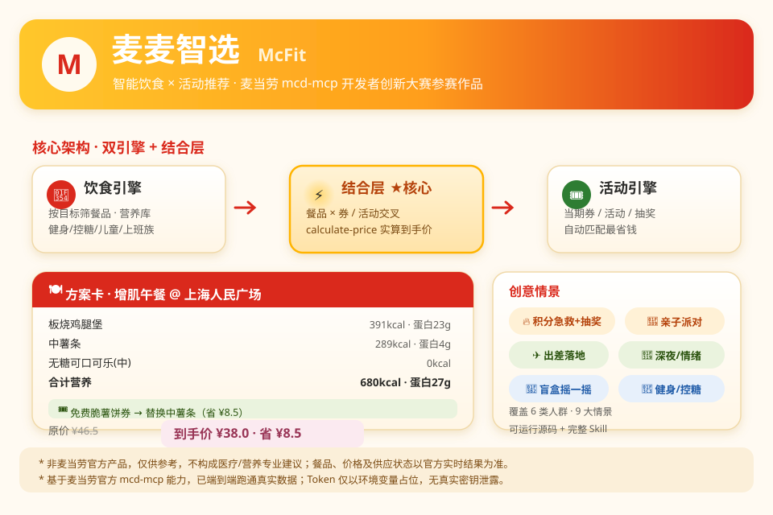
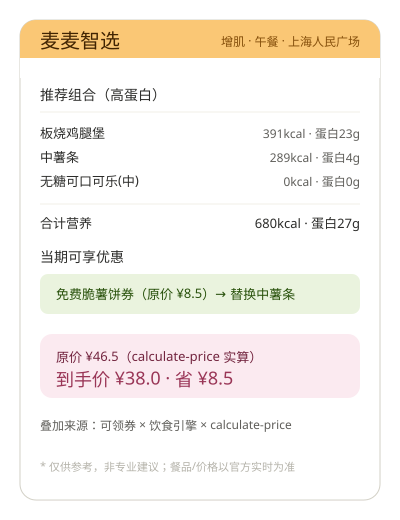

# 麦麦智选 · 麦当劳智能饮食 × 活动推荐 Skill

> 麦当劳程序员节创意开发大赛参赛作品（非官方产品）
> 基于麦当劳官方 `mcd-mcp` 能力，把「吃什么（饮食）」和「怎么买最划算（活动）」打通，
> 输出一份**带营养表和到手价**的个性化方案。

## 为什么需要它

市面上的麦当劳推荐要么是「推套餐」，要么是「推优惠」，二者割裂。本项目的差异点在于
**结合层**：先按你的健身/控糖目标筛出合适餐品，再自动叠加当下能领/能用的券与活动，
用 `calculate-price` 验证到手价，给出「最划算组合」。

而且它不止于此——还提供一系列**创意情景**，让产品从"推荐工具"变成"麦门生活决策伙伴"：

- 健身减脂 / 增肌：高蛋白、控热量、控钠的餐品与组合
- 控糖 / 健康饮食：低糖、无糖饮优先的清淡选择
- 儿童 / 家庭：低钠、小份、温和，带娃点单更安心
- 上班族快手：早餐/工作午餐快速决策、性价比优先
- 🔥 **积分急救 → 抽奖 → 券叠加闭环**：把你"将过期的积分"变成省钱方案的一环
- 🎉 **亲子派对真实建单**：从选城市/门店到真正下单生日派对
- ✈️ **出差旅游落地**：陌生城市附近门店 + 当期活动一键搞定
- 🌙 **深夜 / 情绪场景**：深夜热食优先；累了治愈系、困了提神系
- 🎲 **盲盒摇一摇**：给约束但不想选？随机但不离谱

## 演示海报



## 方案卡演示（细节）



## 功能概览

- **饮食推荐引擎**：基于 `list-nutrition-foods`（160 项营养库）按目标阈值筛选+评分，结合 `query-meals` / `query-meal-detail` / `query-meal-assistance` 给出候选。
- **活动推荐引擎**：聚合 `campaign-calendar` / `query-promotions` / `available-coupons` / `query-store-coupons` / `query-survey-coupon` / `query-lottery-info` / `query-my-coupons`。
- **结合层**：餐品 × 券/活动交叉匹配，`calculate-price` 验证到手价，输出省了多少。
- **积分急救决策引擎**：`scripts/integral_rescue.py` 基于 `query-my-account` + `query-lottery-info` 给出"将过期积分怎么花最划算"的决策。
- **盲盒引擎**：`scripts/blind_box.py` 在约束内随机成组，复用饮食引擎保证合规。
- **离线引擎**：`scripts/recommend.py` 提供可独立运行的确定性推荐（无需联网即可演示逻辑）。

## 安装与使用

### 方式一：作为 WorkBuddy Skill（推荐，可拿 WorkBuddy 专项奖励）

1. 申请麦当劳 MCP Token：登录麦当劳 GitHub 官方账号 → 控制台 → 激活 → 复制 Token。
2. 在 WorkBuddy 左侧「连接器」→「自定义连接器」→「配置 MCP」，粘贴 `mcp-config.example.json`，
   将 `${MCD_MCP_TOKEN}` 替换为你的 Token 并启用 `mcd-mcp`。
3. 将本仓库的 `SKILL.md`（连同 `references/`、`scripts/`）放入 WorkBuddy 的
   `~/.workbuddy/skills/mcd-smart-recommender/` 目录即可生效。
4. 在对话框直接说需求，例如：

   > 我是增肌期，今天午餐想吃点高蛋白的，附近有店吗？顺便看有什么优惠。

   > 我积分是不是快过期了？帮我看看怎么花最划算。

   > 想给孩子在上海办个麦当劳生日派对，能办吗？

### 方式二：本地运行离线引擎（演示/二次开发）

```bash
# 饮食推荐（6 类目标）
python scripts/recommend.py --goal muscle_gain --scene lunch --avoid 猪,辣 --top 6
python scripts/recommend.py --goal low_sugar   --scene afternoon --top 5
python scripts/recommend.py --goal fat_loss    --scene breakfast
python scripts/recommend.py --goal children    --scene dinner   --top 5
python scripts/recommend.py --goal office      --scene breakfast --top 5

# 积分急救决策（用真实账户快照）
python scripts/integral_rescue.py --available 43.2 --expire-now 13.5 --draw-point 24 \
    --prizes "积分霸王餐,麦辣鸡腿汉堡5折券,下单立减3元券"

# 盲盒摇一摇
python scripts/blind_box.py --goal muscle_gain --scene lunch --avoid 猪,辣 --seed 7
```

参数说明：
- `recommend.py`：`--goal`（fat_loss/muscle_gain/low_sugar/balanced/children/office）、`--scene`（breakfast/lunch/afternoon/dinner/night/post_workout）、`--avoid`（忌口，逗号分隔）、`--top`（数量）。
- `integral_rescue.py`：`--available`/`--expire-now`/`--expire-next`/`--draw-point`/`--prizes`，或用 `--json -` 读一段快照。
- `blind_box.py`：`--goal`/`--scene`/`--avoid`/`--pool`(候选池)/`--seed`(可复现)。

## 使用示例

- 完整示例会话：[`examples/sample_session.md`](examples/sample_session.md)
- 积分急救示例：[`examples/sample_integral.md`](examples/sample_integral.md)
- 创意情景明细：[`references/creative_scenarios.md`](references/creative_scenarios.md)

## 目标用户

- 健身/减脂/增肌人群：想吃麦当劳又想控营养
- 控糖/健康饮食人群：需要低糖、清淡选择
- 儿童/家庭人群：低钠、小份、温和，带娃点单更安心
- 上班族：早餐/工作午餐快速决策、性价比优先
- 精打细算用户：希望把优惠精准叠加到真实会点的餐品上
- 会员/积分党：不想让积分悄悄过期，想用抽奖搏优惠券

## 文件结构

```
mcd-smart-recommender/
├── SKILL.md                  # WorkBuddy Skill 定义（双引擎+结合层+创意情景分支）
├── README.md                 # 本文件
├── CONTEST_DECLARATION.md    # 参赛声明（官方原文件，不可修改）
├── MCP_INTEGRATION.md        # MCP Server / Tool / 调用流程 / 业务价值
├── mcp-config.example.json   # 脱敏 MCP 配置（仅环境变量占位）
├── workbuddy.md              # WorkBuddy 专项奖励所需导出文件
├── scripts/
│   ├── recommend.py          # 可运行的饮食推荐引擎（离线演示）
│   ├── integral_rescue.py    # 积分急救决策引擎
│   └── blind_box.py          # 盲盒随机推荐（摇一摇）
├── references/
│   ├── nutrition_rules.md    # 营养阈值 / 场景映射 / 组合价 / 情景叠加层
│   └── creative_scenarios.md # 9 个创意情景明细 + 真实 MCP 能力清单
├── examples/
│   ├── sample_session.md     # 示例会话（基础双引擎）
│   └── sample_integral.md    # 示例会话（积分急救闭环）
└── assets/
    ├── demo_poster.svg       # 演示海报（架构+方案卡+情景）
    └── demo_card.svg         # 方案卡演示图（细节）
```

## 参赛说明

- 本仓库为麦当劳程序员节创意开发大赛公开参赛项目，须保持 **Public**。
- 报名通过活动仓库 Issue 提交（注意：标题与正文之间、字段间暂不用换行；项目地址不用 Markdown 链接）。
- 报名截止 2026-10-25 23:59（北京时间），定榜 2026-10-26 00:00，排名按公开 Star 数。
- 提交 `workbuddy.md` 可参与 WorkBuddy 专项奖励（前 100 名拿 3000 积分）。

## 免责声明

本项目为参赛者独立开发的参赛作品，**非麦当劳官方产品**。输出仅供参考，
**不构成医疗、营养或其他专业建议**；餐品信息、价格及供应状态以麦当劳官方渠道实时结果为准。
配置文件仅使用环境变量占位符，不含任何真实 Token / 密钥。
